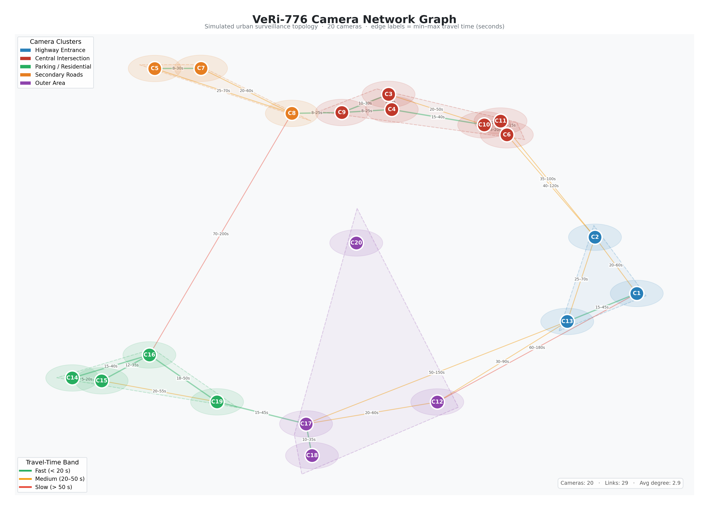

# TemporalReId

Physics-aware temporal filtering for vehicle re-identification across a camera
network. A rule-based **Temporal Consistency Module (TCM)** sits in front of the
[TransReID](https://github.com/damo-cv/TransReID) transformer and removes the
candidate matches that could not physically happen, before any visual comparison
is made. The filter needs no training, no learned parameters and no GPU.

This is the code behind my M.Tech thesis at Rajagiri School of Engineering and
Technology, Kochi, and the paper below.

## Results on VeRi-776

| | Baseline (TransReID) | With TCM |
| --- | ---: | ---: |
| Candidate pairs compared in sequential tracking | 126,063 | 373 |
| Search space pruned | | 99.70% |
| Speed-up in feature comparisons | 1× | 338× |
| mAP, full-gallery retrieval | 82.1% | 82.5% |
| Rank-1 | 97.4% | 97.4% |
| Retraining needed | | None |

The speed-up comes from the sequential tracking setting: follow one vehicle from
camera A to camera B inside a time window. The TCM hard-gates every candidate
whose time gap is impossible for the distance, and 99.70% of them fail. In
full-gallery retrieval the module adds a small penalty to implausible candidates
instead of removing them, which lifts mAP by 0.4 points and leaves Rank-1
unchanged.

## Paper

**Physics-Aware Rule-Based Temporal Filtering for Scalable Vehicle
Re-Identification.** Chris Thomas Saji and Jithin Mathews. Accepted at the
*International Journal of Information Technology and Computer Science (IJITCS)*,
MECS Press, July 2026. The camera-ready LaTeX is in [`docs/paper/`](docs/paper/).

## How it works

1. **Camera network as a graph.** Each camera is a node. Each edge carries the
   straight-line distance between the two cameras (Haversine formula) times a
   tortuosity factor of 1.4, so it approximates the driving distance.
2. **Travel-time bounds.** Each edge gets a speed profile by road type
   (highway, arterial, residential, parking). The lower bound is the fastest legal
   trip; the upper bound is the slowest plausible one, widened during rush hour.
3. **Two modes.** For camera-to-camera tracking the module *hard-gates*: a pair
   whose time gap falls outside the bounds is dropped. For full-gallery retrieval
   it *soft-penalises*: a small additive penalty (λ = 0.02) on the distance matrix,
   so a true match is never deleted, only outranked when a plausible competitor
   looks equally close.
4. **Robustness checks.** The paper tests a 30 s clock guard band, 50 m random
   camera-position errors, and a 20% higher upper speed bound; the filtering rate
   moves only slightly.



VeRi-776 publishes no positions for its 20 cameras, so the camera layout and the
vehicle timestamps the temporal experiments run on are a simulated urban topology
with realistic travel times (`create_realistic_veri_simulation.py`,
`utils/veri_camera_config.py`). The paper describes this setup and its limits.

## What is in the repository

| Path | What it is |
| --- | --- |
| `utils/rule_based_tcm.py`, `utils/rule_based_tcm_v2.py` | The Temporal Consistency Module: Haversine distances, the NetworkX camera graph, travel-time bounds, hard gating and soft penalties |
| `utils/veri_camera_config.py` | The 20-camera layout and speed profiles used for VeRi-776 |
| `create_realistic_veri_simulation.py` | Builds the camera network and writes the simulated timestamps |
| `test_sequential_tracking.py` | The sequential tracking experiment behind the 338× figure |
| `test_rule_based_tcm.py`, `run_ablation.py`, `sweep_tcm_params.py` | Full-gallery evaluation with and without the TCM, the ablation, and the window and penalty sweeps |
| `demo_*.py`, `visualize_reid.py`, `create_visualizations.py` | Demos and figure scripts |
| `frontend/` | A small local web app to browse queries and their cross-camera matches |
| `model/`, `loss/`, `solver/`, `processor/`, `datasets/`, `config/`, `configs/`, `train.py`, `test.py` | TransReID, as released by its authors, with timestamp support added to the VeRi dataset loader |
| `docs/paper/` | The paper's LaTeX source and the journal's class file |

## Running it

Python 3.11 and a CUDA build of PyTorch for the backbone. The TCM itself is NumPy
and NetworkX.

```bash
pip install -r requirements.txt
```

**Data.** VeRi-776 is licensed for research and is not included. Request it from
its authors at <https://vehiclereid.github.io/VeRi/> and unpack it to
`data/VeRi/` (`image_train/`, `image_query/`, `image_test/` and the name lists).

**Weights.** Download TransReID's VeRi-776 checkpoint (`vit_transreid_veri.pth`)
and the ImageNet ViT-B/16 weights it starts from, both linked from the
[TransReID repository](https://github.com/damo-cv/TransReID), into `pretrained/`.

Then:

```bash
# Build the camera network and the simulated timestamps
python create_realistic_veri_simulation.py

# Sequential tracking: the 126,063 -> 373 candidate reduction
python test_sequential_tracking.py --model_path pretrained/vit_transreid_veri.pth --output_dir logs/sequential_tracking

# Full-gallery retrieval, baseline against TCM (mAP and Rank-1)
python test_rule_based_tcm.py --config_file configs/VeRi/vit_transreid_stride.yml --model_path pretrained/vit_transreid_veri.pth

# A ten-second demo of the filtering logic, no dataset needed
python demo_visual_logic.py

# Browse queries and matches in the browser at http://localhost:8765
python frontend/server.py
```

## Credits and licence

- TransReID: Shuting He, Hao Luo, Pichao Wang, Fan Wang, Hao Li and Wei Jiang,
  *TransReID: Transformer-based Object Re-Identification*, ICCV 2021. MIT licence.
- VeRi-776: Xinchen Liu, Wu Liu, Tao Mei and Huadong Ma, *PROVID: Progressive and
  Multimodal Vehicle Reidentification for Large-Scale Urban Surveillance*, IEEE
  Transactions on Multimedia, 2018.

This repository is released under the [MIT licence](LICENSE). The TransReID
portions keep their original copyright notice.
